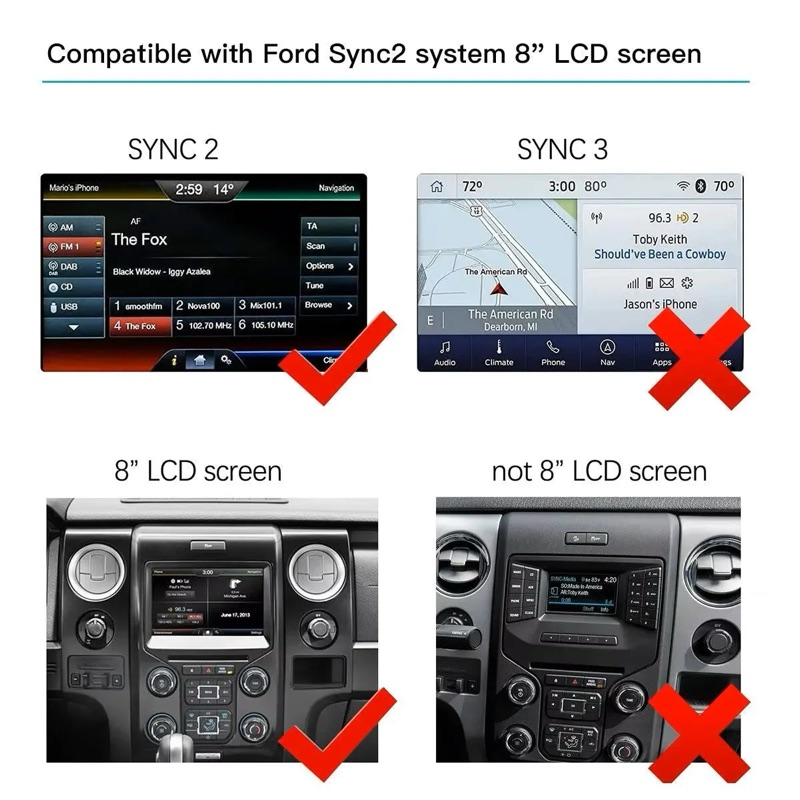

<h1 align="center">sync2-auto-magic</h1>

<p align="center">
  <b>Apple CarPlay on the Ford that never got it.</b><br>
  One USB adapter, one USB stick and free software, on the factory 8" SYNC 2 / MyFord Touch screen.
</p>

<p align="center">
  
  
  
  
  <a href="https://github.com/Theralley/sync2-auto-magic/releases"></a>
  <a href="LICENSE"></a>
</p>

<p align="center">
  <a href="https://www.buymeacoffee.com/theralley">
    
  </a>
</p>

Your 2013–2016 Ford has a good 8" touchscreen and no CarPlay. Ford's answer was SYNC 3 in the
next car. This project's answer is a Carlinkit adapter for about 40 euros, a USB stick, and a
toolkit that installs, patches and checks everything from your Mac. No soldering, no new head
unit, and the firmware is never touched.

## What it does today

Everything in this list has run in a real car, not just on a desk.

- **CarPlay on the factory screen:** Apple Maps with route guidance, Spotify, the home screen,
  touch.
- **Sound through the car's speakers.** AutoKit is silent on SYNC 2 out of the box; this project
  patches it so SYNC's audio system lets it play.
- **Siri and phone calls through the car's own microphone** (new, 19 November 2026).
- **No frozen screen when you leave CarPlay.** The runner guard brings SYNC back in about three
  seconds.
- **Your Mac runs the show.** Every change travels on a USB stick as a small job. The car backs
  up what it replaces, the Mac checks the report that comes back, and the changes have an
  undo.
- **See, install and remove SYNC apps** from the Mac, and **restyle Ford's own menus** with
  [sync-redesign](https://github.com/Theralley/sync-redesign).
- **AutoKit in English** instead of Chinese.

## What it does not do yet

This is an honest project, so here is the other half.

- **It is slow.** SYNC 2's 600 MHz processor decodes CarPlay's video in software and sits near
  100%. A smaller picture (640×384) helps a lot; a faster decoder, a lower priority for Ford's
  own screen program (`flash-tune`) and processor-clock research are in progress:
  [docs/PERFORMANCE.md](docs/PERFORMANCE.md).
- **Calls work, but the other side hears an echo** and choppy sound.
- **Android Auto** uses the same adapter and is not tried yet.
- **One car so far.** It is tested on one 2016 Mondeo. Reports from other SYNC 2 cars are very
  welcome.

Try it only if you are comfortable with the recovery steps in
[docs/TROUBLESHOOTING.md](docs/TROUBLESHOOTING.md).

## Support the project

This is one person, one Mondeo and a great many walks to the car park with a USB stick. If it
put CarPlay in your Ford, or you just enjoy watching a 2013 head unit learn new tricks:

- [**Buy me a coffee**](https://www.buymeacoffee.com/theralley). It goes to adapters, USB sticks
  and test hardware.
- **Star the repository**, so other SYNC 2 owners find it.
- **Tell us about your car** in an [issue](https://github.com/Theralley/sync2-auto-magic/issues):
  model, year, SYNC version, and what worked.

## Latest news

- **20 November 2026:** first tagged version,
  [v0.1.0 (pre-release)](https://github.com/Theralley/sync2-auto-magic/releases/tag/v0.1.0).
- **20 November 2026:** `flash-tune` lowers the priority of Ford's screen program so CarPlay
  gets more of the processor. Written and verified on the car; its effect is being measured.
- **19 November 2026:** the microphone works over CarPlay (`s2am job autokit-mic-gate`). Siri
  hears you and calls connect.
- **16 November 2026:** decoder and clock research, with the measurements behind them:
  [docs/PROGRESS-2026-11-16.md](docs/PROGRESS-2026-11-16.md).
- **4 November 2026:** first CarPlay session in the car, installed with these tools.

## Tested and working

Tested in a real car: a **2016 Ford Mondeo Mk5, 8" SYNC 2, software 3.10 (EU)**, on
**30 October to 20 November 2026**. Details in [docs/P1-TESTLOG.md](docs/P1-TESTLOG.md) and the
[latest development update](docs/PROGRESS-2026-11-16.md).

| What | Result in the car |
|---|---|
| Mac → USB stick → car → report back on the stick | **Works** |
| Read what is installed on SYNC (`inventory`) | **Works** |
| Remove apps with their files, several on one stick | **Works** (Video Player, MirrorLink, Navitel); SYNC restarts by itself |
| Install AutoKit + Total Commander + Reboot on a car that already had SyncExtPack (`--apps-only`) | **Works**; all three appear under *Apps* |
| Total Commander (file manager) | **Works** |
| Reboot button | **Works** |
| AutoKit opens | **Works**: shows its "connect the adapter" screen |
| AutoKit in English | **Works** (`autokit-config --lang english`; new installs now start in English) |
| AutoKit's sound patch installed | **Yes**: all three audio modules patched |
| Apple CarPlay over a cable (iPhone, CarlinKit wired adapter) | **Works, but very slow**: home screen, taps, Maps with route guidance, Spotify. [docs/PERFORMANCE.md](docs/PERFORMANCE.md) |
| CarPlay sound through the car's speakers | **Works**: Spotify over CarPlay, with the iPhone's Bluetooth off, so the sound came through the cable and AutoKit (14 November) |
| Leave AutoKit with its Exit button, with the runner guard (`runner-guard`) | **Works**: SYNC is back about 3 s after Exit (four tries) |
| Siri and a phone call over CarPlay, through the car's microphone (`autokit-mic-gate`) | **Works** (19 November); the other side hears an echo and choppy sound |
| Soft reset when the screen is stuck (power/volume knob + Seek-Up ⏭, 10 s) | **Worked once**; twice later it did not, and switching the car off did |

**Not tested yet:**
- The A/B test of the sound patch: whether CarPlay's sound also works without it.
- Android Auto: the adapter is here, not tried yet.
- The first install through the wallpaper picker (`Installer.jpg`): the test car already had
  SyncExtPack.
- The guided installer (`s2am wizard`): tested on the Mac only.

**Known problems:**
- Without the runner guard, leaving AutoKit with its Exit button freezes the screen, because
  Exit only hides AutoKit. Install the guard (`s2am job runner-guard`). Without it, recover by
  switching the car off and opening and closing the driver's door.
- **SYNC 2 is very slow, with CarPlay and on its own screens:** taps react late and CarPlay's
  picture is choppy. Measured 2026-11-14: with CarPlay running, the processor is at 100%, and
  most of that is AutoKit's software video decoding. Open issue, with what is known and the plan:
  [docs/PERFORMANCE.md](docs/PERFORMANCE.md).
- **Calls over CarPlay have poor sound for the other side** (2026-11-19: echo, choppy, late). The
  microphone itself works after `autokit-mic-gate` ([TROUBLESHOOTING.md](docs/TROUBLESHOOTING.md)).
- **Switching to the radio while CarPlay plays** stopped CarPlay's music, and pulling the cable
  out and in did not bring CarPlay back ([TROUBLESHOOTING.md](docs/TROUBLESHOOTING.md)).
- **After Exit, CarPlay sometimes cannot be started again** until SYNC is restarted. Seen
  2026-11-14 and 2026-11-15. AutoKit is then still running, hidden: the runner guard closes a
  hidden AutoKit only while nothing else is on the screen, and another window got there first
  (on 2026-11-15, the installer's, 1 s after Exit). A fix is written but not yet in the car: the
  guard also closes an app whose own window has been gone for 5 s, whatever else is on the
  screen. It reaches the car with the next `s2am job runner-guard` stick. Until then, restart
  SYNC, and wait a few seconds after Exit before inserting a stick
  ([P1-TESTLOG.md](docs/P1-TESTLOG.md), 2026-11-15).
- The parking sensors' pop-up does not appear while AutoKit is open. Leave AutoKit before
  reversing ([TROUBLESHOOTING.md](docs/TROUBLESHOOTING.md)). A reverse camera is untested: the
  test car has none.

---

## Will this work in my car?

<p align="center">
  
</p>

| System | Works? |
|---|---|
| **SYNC 2 / MyFord Touch with the 8" touchscreen** | Yes, this is what it is made for |
| SYNC 3 | No, it already has CarPlay built in |
| Small screen with buttons around it (SYNC 1) | No, a different system |
| SYNC software **3.08 or 3.10** | Needed; check under *Settings → General → About SYNC* |

Typical cars include the Focus, Mondeo, Kuga, C-Max and S-Max/Galaxy (2013–2016), plus North American
models with MyFord Touch. The developer's car is a **2016 Ford Mondeo Mk5**. Other SYNC 2 cars
run the same system, but nothing is guaranteed.

## What you get

| Feature | Status |
|---|---|
| AutoKit installed and opening on SYNC 2 | **Works in the car** |
| AutoKit in English | **Works in the car**; new installs start in English (the stock app is Chinese; `autokit-config --lang` changes it) |
| Apple CarPlay over a cable | **Works in the car, very slow** (2026-11-04): [docs/PERFORMANCE.md](docs/PERFORMANCE.md) |
| A smaller CarPlay picture to lower the load (`autokit-config --screen 640,384,10`) | **Works in the car** (2026-11-15): the processor is no longer full all the time and CarPlay feels much faster; the picture sits in the middle with a black frame. The car is left on this setting |
| Faster video decoder files for AutoKit, our own FFmpeg build (`s2am job decoder`, with its undo stick) | About 20% fewer emulated instructions with matching test pictures; **no measured car speed gain yet**. Both inspections found stock DLLs; the corrected installation awaits its first car test. The binaries are not in this repository ([next tests](docs/PERFORMANCE.md#next-useful-tests-november-16)) |
| The car's microphone for Siri and calls (`s2am job autokit-mic-gate`, undo with `autokit-patched`) | **Works in the car** (2026-11-19). Call quality for the other side is not good yet: echo, choppy, late ([TROUBLESHOOTING.md](docs/TROUBLESHOOTING.md)) |
| Less processor time for Ford's own screen program (`s2am job flash-tune`, undo with `--undo`) | **Written and verified on the car** (2026-11-19, priority 253); the effect on CarPlay is not measured yet ([docs/PERFORMANCE.md](docs/PERFORMANCE.md)) |
| More CPU time for foreground CarPlay (`runner-guard --boost 250 --measure`) | Guarded priority comparison prepared in source, **not yet tested in the car**. Priority restoration and actual sampling gaps must be checked ([plan](docs/PROGRESS-2026-11-16.md#goal-2-give-foreground-carplay-more-processor-time)) |
| A higher processor clock (overclocking) | **Active research; no validated CPU transition yet.** The standalone clock reader failed with mapping error 87. A separate read-only driver prototype has passed host tests and a server build; independent review completed; USB integration and car activation remain pending ([clock goals](docs/PROGRESS-2026-11-16.md#goal-3-a-controlled-overclock-experiment)) |
| Independently inspect a decoder attempt (`s2am job decoder-inspect --target JOB_ID`) | **File collection worked in the car on November 16.** Active/backup/staged DLLs were verified; the separate clock child failed explicitly. A second inspection confirmed the later attempt left stock files. It changes no decoder or clock setting |
| Read MC13892 voltage presets through the existing driver (`s2am job pmic`) | **Registers 7/24/28 work in this car** (2026-11-16, as part of `clock`): presets 1050/1050/700 mV, SW1MODE 9, SID disabled. Active CPU voltage remains unmeasured; no voltage or clock changes ([findings](docs/CLOCK-MODULE-CAPTURE-2026-11-16.md)) |
| Collect clock evidence in one visit (`s2am job clock`) | **Original profile works in the car** (2026-11-16): both reports completed; registry has 950 keys and 3,792 values. The later targeted profile also validates the new PMIC mode read. No reboot or clock/voltage changes; each diagnostic's outcome is checked separately on import |
| Inspect clock/power files and PMIC mode (`s2am job clock --modules`) | **Completed in the car** (2026-11-16): seven ROM modules, one missing named file, zero binaries copied. PMIC mode read succeeded. The ordinary-file copy branch remains untested in this car; no overclock is applied ([findings](docs/CLOCK-MODULE-CAPTURE-2026-11-16.md)) |
| Copy SYNC's registry and system files to the stick, read-only (`s2am job registry --fetch`) | **Works in the car** (2026-11-15) for the registry and six requested files; 15 program files did not copy and the cause was not logged. The screen stands still at 100% for minutes while it works: leave the stick in |
| Sound through the car's speakers | Fix installed (all three modules patched). Spotify over CarPlay plays through the speakers with the iPhone's Bluetooth off (14 November), so the sound comes through AutoKit. The Video Player, which gets its sound through the same `WaveOutHooks.dll`, plays through the speakers in the car |
| Leaving AutoKit returns to SYNC | **Works in the car with the runner guard** (`s2am job runner-guard`, undo with `--off`). Without it, Exit only hides AutoKit and the screen freezes. Reported upstream: [syncextpack#4](https://github.com/chr0m1ng/syncextpack/issues/4) |
| New colours for SYNC's menus (`s2am job theme`; Lincoln's colours now, your own next) | **Works in the car**: the change and its undo stick both verified byte for byte (2026-10-31). How to undo: [sync-redesign RECOVERY.md](https://github.com/Theralley/sync-redesign/blob/main/docs/RECOVERY.md) |
| A new Apps menu with big tiles, CarPlay first (`s2am job apps-menu`) | Built and rehearsed on the computer with the car's files; **first car test 2026-10-31**. Built by [sync-redesign](https://github.com/Theralley/sync-redesign)'s `tools/build_apps_menu.py` from your own copy of SyncExtPack's menu |
| One of Ford's own screens, rebuilt (`s2am job screen`: the call history, Settings > Display, the frame, Home) | **Works in the car** (call history 2026-11-01, the restyled frame 2026-11-01 and 11-02). The frame (`AppConsole.swf`), Home and the files they load (Home's four corners, the labels in the frame's bars, `Media.swf`, the side menus `Menu.swf` and `Info.swf`) load when SYNC starts and need `--startup`, with the undo stick built at the same time; a new start-up file must differ in length from Ford's, since the car checks a copy by its size; built by [sync-redesign](https://github.com/Theralley/sync-redesign) from your own copy |
| Call sound: boxy, no bass (narrowband or wideband?) | Two read-only loggers, built 2026-10-31: the iPhone's Bluetooth log read by `tools/hfp_codec.py`, and SYNC's own settings (`s2am job registry`). How: [docs/CALL-SOUND.md](docs/CALL-SOUND.md) |
| Several jobs in one visit to the car (`s2am job bundle`) | Built and rehearsed (2026-10-31): jobs already built run in one go, in order, each verified on its own after import; the first that stops ends the run. An undo bundle puts everything back in one go |
| Parking sensors' pop-up while AutoKit is open | **Does not show** (seen in the car); leave AutoKit before reversing. A reverse camera is untested: the test car has none |
| Play MP4 videos from a USB stick (SyncExtPack's Video Player) | **Works in the car** at 800x480 (H.264), with sound and correct colours; 720p and 1080p glitch, and the sound runs slightly off the picture. Install with `s2am job install "Video Player"`; test videos from `tools/make_test_videos.py`. Parked only |
| Android Auto with the same dongle | Not tried yet (`autokit-config` sets the picture; [plan](docs/P2-AA-AUTOSTART-PLAN.md)) |
| See what is installed on SYNC 2 from your Mac | **Works in the car** |
| Drive logger for a redesign: system facts, processor load, every file, a copy of Ford's screens (`logger --drive`) | **Works in the car** (one 22-minute drive). Its screen copies show only the coloured background, not the Flash screens. Findings: [sync-redesign](https://github.com/Theralley/sync-redesign/blob/main/docs/FINDINGS.md) |
| Measure speed: the processor's load per program and thread (`logger --load`, then `logger --collect` on a second stick) | **Load traces collected in the car**, including 800×480 and 640×384 comparisons. These are CPU samples, not frame-rate measurements ([docs/PERFORMANCE.md](docs/PERFORMANCE.md)) |
| Remove apps from your Mac (one or several per stick, menu only or with their files) | **Works in the car** |
| Install apps from your Mac (SyncExtPack apps, AutoKit with the sound fix) | **Works in the car**: the full app pack, and single apps (Video Player) |
| CarPlay starts by itself when you plug in the phone | Being investigated: diagnostic jobs ready (`snapshot`, `logger`), the auto-start itself not built yet ([plan](docs/P2-AA-AUTOSTART-PLAN.md)) |

## What you need

- [ ] **A Carlinkit wired adapter** (the "AutoKit" type for Android head units), for example
      [this one on Amazon.se](https://www.amazon.se/dp/B0919JS1K3) (about 410 SEK).
      Do **not** buy "wired-to-wireless" adapters (2Air, U2W, Mini Ultra, 3.0/4.0/5.0). They
      only work in cars that already have CarPlay.
- [ ] **A USB stick**, 32 GB or smaller, formatted **FAT32**
- [ ] **A Mac** with [Docker Desktop](https://www.docker.com/products/docker-desktop/) and Python 3
      (Windows and Linux are untested)
- [ ] **Your APIM serial**: 8 characters, under *Settings → General → About SYNC*

## Easiest: the guided installer

**New here? Follow the [step-by-step install guide](docs/INSTALL.md)** (also
[in Swedish](docs/INSTALL.sv.md)). It goes from an unopened adapter to CarPlay on the screen,
in plain words, with no Terminal needed.

No terminal experience needed. It asks plain questions, checks your Mac and USB stick, builds
everything, and tells you exactly what to do in the car, one trip at a time.

1. Install [Docker Desktop](https://www.docker.com/products/docker-desktop/) and start it.
2. Download this project: the green **Code** button → **Download ZIP**, then unzip it, or
   use `git clone https://github.com/Theralley/sync2-auto-magic`.
3. Plug in a USB stick (32 GB or less).
4. Open the folder and **double-click `Install-SYNC2.command`**. If macOS blocks it, right-click
   it and choose *Open*. Or run `python3 -m s2am wizard` in Terminal.

The installer offers:

- **Install CarPlay / Android Auto.** It finds out whether your car already has SyncExtPack
  and picks the right route by itself.
- **See what is on my SYNC.**
- **Remove apps.**
- **Help: SYNC is frozen.**
- **Make CarPlay better (after the install).** The runner guard, a smaller and faster CarPlay
  picture, and the car's microphone, one car visit each.

If SyncExtPack (an upstream project) is missing, it offers to download it. Type `q` at any
prompt to stop; nothing is lost.

## Quick start (terminal)

**1. Get the code.** Both folders must sit next to each other.

```sh
git clone https://github.com/Theralley/sync2-auto-magic
git clone https://github.com/chr0m1ng/syncextpack
cd sync2-auto-magic
```

**2. Check the stick and put the install pack on it.** Start Docker Desktop first.

```sh
python3 -m s2am stick check /Volumes/SYNC                                  # must show no FAIL
python3 -m s2am bootstrap prepare --serial YOURSERIAL --stick /Volumes/SYNC
```

This builds the pack, writes it to the stick, verifies every file and ejects the stick. It
prints an **"install before"** date: packs only work inside a 30-day window.

**3. Install it in the car.** Keep the engine running, with Start-Stop off.

1. Insert the stick and go to *Settings → Display → Wallpaper → Add*. Pick the USB stick and
   select **`Installer.jpg`**. SYNC restarts.
2. Take the stick out. On your Mac run
   `python3 -m s2am bootstrap finish /Volumes/SYNC` (this is the "rename" step, done safely).
3. Put the stick back in. The installation starts by itself, so wait for
   **"Install successfully completed!"**.

**SyncExtPack already on the car?** If an older SyncExtPack is installed (an extra Apps menu
from a previous owner, for example), skip the wallpaper step: run an inventory job first (below).
If it comes back, the car's installer works, and one stick does the whole install:

```sh
python3 -m s2am bootstrap prepare --serial YOURSERIAL --stick /Volumes/SYNC --apps-only
```

That puts only the app pack on the stick, as `install.bin`. Insert it, wait for
**"Install successfully completed!"** and the restart. The Apps menu is rewritten with AutoKit,
Total Commander and Reboot.

First time? Follow the step-by-step **[Phase 1 runbook](docs/P1-RUNBOOK.md)**. It covers the
recovery stick, what to check at every step, and the CarPlay sound test. The upstream guide is
SyncExtPack's [installation guide](https://github.com/chr0m1ng/syncextpack/blob/main/SYNCEXTPACK_INSTALLATION.md).

**4. Use it.** Plug the Carlinkit adapter into the car's USB port and connect your iPhone to the
adapter with its cable. Then press **i → Apps → AutoKit**.

## How the Mac reaches SYNC 2

Not with a cable to SYNC's USB port: SYNC 2's ports are host-only, and an A-to-A cable can damage
hardware. Files and apps travel on a **USB stick**. Diagnostics and a remote SYNC restart go
through the **OBD-II port** with [forscan-mac](https://github.com/Theralley/forscan-mac). See
[docs/CONNECTING.md](docs/CONNECTING.md).

## See what is on your SYNC 2 from your Mac

`s2am` puts a small "job" on a USB stick. The car runs it, writes a report back onto the
stick, and your Mac shows the result.

```sh
python3 -m s2am job inventory --serial YOURSERIAL           # 1. make the job
python3 -m s2am stick prepare /Volumes/YOURSTICK --job build/jobs/<id>   # 2. put it on the stick
#   3. in the car: insert the stick, wait for "Install successfully completed", pull it out
python3 -m s2am stick import /Volumes/YOURSTICK             # 4. read the report
python3 -m s2am status --serial YOURSERIAL                  # installed apps, menu, free space
python3 -m s2am diff --serial YOURSERIAL                    # what changed since last time
```

A stick never runs the same job twice, even if you leave it in. Jobs never touch the firmware.

## Android Auto and diagnostics (Phase 2)

```sh
python3 -m s2am job autokit-config --serial YOURSERIAL               # AutoKit video 800x480, software decoding
python3 -m s2am job autokit-config --serial YOURSERIAL --lang english # AutoKit in English (video left alone)
python3 -m s2am job theme --preset lincoln --serial YOURSERIAL       # Lincoln's colours (needs a drive log first)
python3 -m s2am job theme --restore JOB_ID --serial YOURSERIAL       # the undo stick for that theme job
python3 -m s2am job apps-menu --swf NEW.swf --tiles DIR --serial YOURSERIAL  # a new Apps menu (see sync-redesign)
python3 -m s2am job apps-menu --restore JOB_ID --serial YOURSERIAL   # the undo stick for it
python3 -m s2am job cleanup --serial YOURSERIAL                      # remove s2am's old job folders (backups stay)
python3 -m s2am job screen --screen Phone/PhoneHistory/PhoneHistory.swf --swf NEW.swf --serial YOURSERIAL
python3 -m s2am job screen --screen Home/Home.swf --startup --swf NEW.swf --serial YOURSERIAL  # loads at start-up
python3 -m s2am job screen --restore JOB_ID --serial YOURSERIAL      # the undo stick for it
python3 -m s2am job bundle --part build/jobs/ID1 --part build/jobs/ID2 --serial YOURSERIAL  # several, one run
python3 -m s2am job registry --serial YOURSERIAL                     # read-only: SYNC's settings, for the call sound
python3 tools/hfp_codec.py the.pklg                                  # narrowband or wideband, from an iPhone log
python3 -m s2am job autokit-config --serial YOURSERIAL --restore <id> # put the old settings back
python3 -m s2am job snapshot --serial YOURSERIAL                     # read-only: services, startup, USB devices
python3 -m s2am job logger --serial YOURSERIAL                       # 3 minutes: every program and window on the screen
python3 -m s2am report --serial YOURSERIAL                           # show the newest report (snapshot, log timeline)
python3 -m s2am native build                                         # build the WinCE helpers (CeGCC in Docker)
python3 -m s2am job native-hello --serial YOURSERIAL                 # prove compiled code runs on your SYNC 2
python3 -m s2am job runner-guard --serial YOURSERIAL                 # fix: no frozen screen after leaving an app
python3 -m s2am job runner-guard --off --serial YOURSERIAL           # put SyncExtPack's original launcher back
python3 -m s2am job runner-guard --boost 250 --measure 600 --serial YOURSERIAL  # untried priority comparison
python3 -m s2am job runner-guard --boost off --serial YOURSERIAL     # the guard stays, the boost goes
python3 -m s2am job autokit-mic-gate --serial YOURSERIAL             # Siri and calls through the car's microphone
python3 -m s2am job flash-tune --prio 252 --fast-prio 252 --serial YOURSERIAL  # Ford's screens take less processor
python3 -m s2am job flash-tune --undo --serial YOURSERIAL            # Ford's values back
python3 -m s2am job logger --native --serial YOURSERIAL              # also record AutoKit's window messages
python3 -m s2am job logger --drive --serial YOURSERIAL               # while you drive, up to 4 h: load, files, Ford's screens
python3 tools/make_test_videos.py OUTFOLDER                          # test videos for the Video Player (needs ffmpeg, Pillow)
```

See [docs/P2-AA-AUTOSTART-PLAN.md](docs/P2-AA-AUTOSTART-PLAN.md). `autokit-config` also removes any
dongle firmware image from AutoKit's folder, because AutoKit would flash it.

## Install an app from your Mac

`s2am` installs SyncExtPack's own apps: AutoKit, Video Player, MirrorLink, Total Commander,
Navitel and others. Run `s2am apps` to see the list. You need a recent inventory report first.

```sh
python3 -m s2am apps --serial YOURSERIAL                                  # what can be installed, what is on the car
python3 -m s2am job install "Video Player" --serial YOURSERIAL --dry-run  # show what would be copied
python3 -m s2am job install "Video Player" --serial YOURSERIAL            # copy it and add it to the menu
python3 -m s2am job install "AutoKit" --serial YOURSERIAL --reinstall     # update an app that is already there
```

The app goes into the first free slot of the Apps menu, using the same safe menu change as
removal: backup, content check, verified copy. AutoKit always gets the sound patch and starts in English. Restart
SYNC before inserting the stick if the app is running. Every job pack is unpacked again on the
Mac and checked file by file before you get it.

## Remove an app from your Mac

Use the name exactly as `s2am status` shows it in the menu (for example `"Video Player"`).
You need a recent inventory report first, because the removal is planned from it.

```sh
python3 -m s2am job remove "Video Player" --serial YOURSERIAL --dry-run   # show what would change
python3 -m s2am job remove "Video Player" --serial YOURSERIAL             # hide it from the Apps menu
python3 -m s2am job remove "Video Player" --serial YOURSERIAL --purge     # ...and delete its files
python3 -m s2am job remove MirrorLink Navitel --serial YOURSERIAL --purge  # several apps on one stick
python3 -m s2am job undo <remove-job-id> --serial YOURSERIAL              # put it back in the menu
```

Then take the job stick to the car, as above. SYNC restarts after the job.

- **Without `--purge`** the app only disappears from the menu. Its files stay, so `undo` brings
  it back completely.
- **With `--purge`** the app's own folder, plugin and icon are deleted. `undo` restores only the
  menu entry; to get the app back, install it again.
- **Before changing anything**, the car backs up the menu and checks that the menu is exactly
  as your report showed it (content, not just size) and that the app isn't running. If either
  check fails, nothing changes and `stick import` tells you why.
- **Nothing is deleted until the new menu is confirmed on the car.** If writing it fails, the
  old menu is put back. If the power goes in the middle of a purge, the same stick finishes
  the job next time.
- **Undo** runs only if the menu is still exactly what that removal left behind, so it can't
  bring back an entry whose files were deleted later.
- **Never deleted:** shared things (the Tools folder and the app launcher), icons or plugins that
  another menu entry still uses, and anything outside the app's own SyncExtPack folders. Registry
  entries the app added (AutoKit's `box.reg`) are left as they are.

## If something goes wrong

Search **[docs/TROUBLESHOOTING.md](docs/TROUBLESHOOTING.md)** for the exact words you see; every entry there was met in a real car or build. The short version:

| Problem | What to do |
|---|---|
| **Touchscreen frozen** after closing AutoKit | Install the runner guard (`s2am job runner-guard`); it fixes this, verified in the car. To recover now: switch the car off and open and close the driver's door. The soft reset (**power/volume knob + Seek-Up** ⏭, about 10 s) worked once but not after this freeze. Nothing is uninstalled either way. |
| **Nothing happens** when a stick goes in right after starting the car or restarting SYNC | SYNC was not ready. Pull the stick out, wait until SYNC has finished starting, and insert it again. |
| **A job stick shows a MortScript error** | Take a photo of it, tap OK and import the stick. `s2am` checks every script against the car's MortScript rules before it builds a stick ([docs/MORTSCRIPT.md](docs/MORTSCRIPT.md)). |
| **CarPlay shows but there is no sound** | That is exactly what this project is testing. Please [open an issue](https://github.com/Theralley/sync2-auto-magic/issues) and include your SYNC version. |
| **Undo the sound fix** | Open Total Commander (it is in *Apps*) and go to `\SyncExtendedPack\Apps\Media\AutoKit\`. Rename the `*.orig` files back to their original names. |
| **Remove everything** | Reinstall SYNC software 3.10 or 3.08 with the [firmware guide](https://github.com/chr0m1ng/syncextpack/blob/main/FIRMWARE_INSTALLATION.md). |

## How it works

<details>
<summary><b>Why AutoKit has no sound on SYNC 2, and how it is fixed</b></summary>

SYNC 2 only plays an app's sound after the app asks Ford's audio system (`RAC.dll`) for a
route. The community's VideoPlayer and Navitel apps do this through a small helper,
`WaveOutHooks.dll`. Carlinkit's AutoKit doesn't, so you get a picture but no sound.

`tools/patch_waveout.py` makes AutoKit use the same helper. It changes how
`AutoKit.exe`, `libgstwaveoutsink.dll` and `libgstwaveform.dll` load their sound functions,
copying the patch that already works in VideoPlayer. The originals are kept as `*.orig`.
</details>

<details>
<summary><b>How the Mac talks to the car</b></summary>

After the first install, SyncExtPack leaves a service on SYNC 2. It runs any
`SyncExtPack\install.bin` it finds on a USB stick and then writes a log back to the stick.
`s2am` uses that as a job channel:

- each job runs a small MortScript;
- the script writes its report to `\USB Disk\s2am\reports\<job>\`;
- it leaves a "done" marker on the car, so a job can never run twice.

Packs are built with SyncExtPack's own `crypto_pack` inside a Docker container, so its
third-party tools never run directly on your Mac. Read
[docs/TOOLKIT-PLAN.md](docs/TOOLKIT-PLAN.md) for the full design and roadmap.
</details>

<details>
<summary><b>For developers</b></summary>

```sh
python3 -m unittest discover -s tests       # about 660 tests; uses ../syncextpack (tested at 1a1eda0)
python3 tools/make_pack.py SERIAL --dry-run  # stage and patch only, no build
python3 -m s2am window                       # is the current 30-day key window safe to build in?
```

| Folder | What is inside |
|---|---|
| `tools/` | `patch_waveout.py` (the sound fix), `make_pack.py` (builds the install pack) |
| `s2am/` | The Mac toolkit: jobs, USB stick, reports, status/diff, the guided installer (`wizard.py`), a fake SYNC 2 for tests |
| `docker/` | The offline Linux container that runs SyncExtPack's build tools |
| `s2am/native/` | C sources of the WinCE helpers (`hello.exe`, `notifylog.exe`, the runner guard `s2amrun.exe`, the watcher `s2amwatch.exe`), built with CeGCC |
| `docs/` | [PLAN.md](docs/PLAN.md) (research and decisions), [TOOLKIT-PLAN.md](docs/TOOLKIT-PLAN.md), [TROUBLESHOOTING.md](docs/TROUBLESHOOTING.md) (symptom → fix), [MORTSCRIPT.md](docs/MORTSCRIPT.md) (the car's script rules), [P1-TESTLOG.md](docs/P1-TESTLOG.md) (car results) |

The `../syncextpack` clone is never modified. State is kept in `~/.s2am/<serial>/`; set
`S2AM_HOME` to change it.
</details>

## Like it?

If this saved you the price of a new head unit, a
[coffee](https://www.buymeacoffee.com/theralley) is a nice way to say so. A star and a report
from your car help just as much.

## Disclaimer

Changing your SYNC 2 software is at your own risk and may affect your warranty. Do not set
anything up while driving. This project is not affiliated with Ford, Apple, Google or Carlinkit.

## License

The code and documentation in this repository are licensed under the [MIT License](LICENSE).
The license does not cover third-party material: SyncExtPack and its bundled tools, AutoKit,
MortScript, and the compatibility picture keep their own terms.

## Credits

- [SyncExtPack](https://github.com/chr0m1ng/syncextpack) by chr0m1ng and the XDA MyFord Touch
  community, which made sideloading on SYNC 2 possible
- Carlinkit, for AutoKit; MortScript by Mirko Schenk
- The compatibility picture comes from a SYNC 2 product listing on AliExpress
