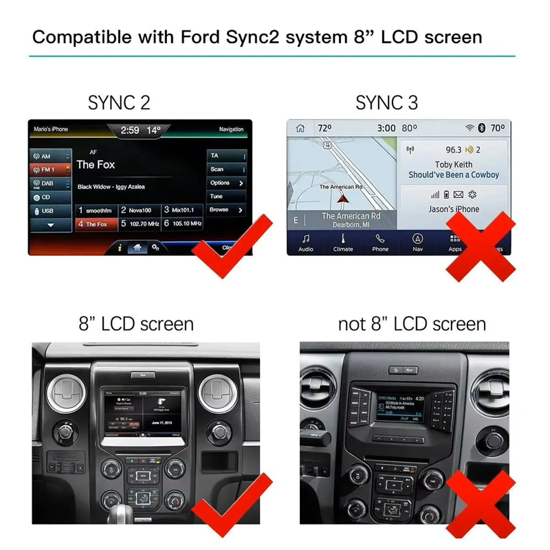

# sync2-auto-magic

**Apple CarPlay (and soon Android Auto) for Ford SYNC 2 / MyFord Touch, using one USB dongle
and free software.** It also includes a Mac tool that shows what is installed on your SYNC 2.

> **Status: experimental.** Everything here is built and tested on a computer, but has **not
> yet been confirmed in a car**. The first in-car test (2016 Ford Mondeo Mk5) is coming. Try it
> only if you are comfortable with the recovery steps below.

---

## Will this work in my car?

<p align="center">
  
</p>

| | |
|---|---|
| ✅ **SYNC 2 / MyFord Touch with the 8" touchscreen** | This is what it is made for |
| ❌ SYNC 3 | Already has CarPlay built in |
| ❌ Small screen with buttons around it (SYNC 1) | Different system |
| ✅ SYNC software **3.08 or 3.10** | Check under *Settings → General → About SYNC* |

Typical cars include the Focus, Mondeo, Kuga, C-Max and S-Max/Galaxy (2013–2016), plus North American
models with MyFord Touch. The developer's car is a **2016 Ford Mondeo Mk5**. Other SYNC 2 cars
run the same system, but nothing is guaranteed.

## What you get

| Feature | Status |
|---|---|
| 🍎 Apple CarPlay over a cable | Ready to test |
| 🔊 Sound through the car's speakers | Fix built, **not yet confirmed in a car** |
| 🤖 Android Auto with the same dongle | Planned ([plan](docs/P2-AA-AUTOSTART-PLAN.md)) |
| 💻 See what is installed on SYNC 2 from your Mac | Ready to test |
| 🗑️ Remove apps from your Mac (menu only, or with all their files) | Ready to test |
| 📦 Install apps from your Mac (SyncExtPack apps, AutoKit with the sound fix) | Ready to test |
| ⚡ CarPlay starts by itself when you plug in the phone | Planned ([plan](docs/P2-AA-AUTOSTART-PLAN.md)) |

## What you need

- [ ] **A Carlinkit wired adapter** (the "AutoKit" type for Android head units), for example
      [this one on Amazon.se](https://www.amazon.se/dp/B0919JS1K3) (about 410 kr).
      ⚠️ Do **not** buy "wired-to-wireless" adapters (2Air, U2W, Mini Ultra, 3.0/4.0/5.0). They
      only work in cars that already have CarPlay.
- [ ] **A USB stick**, 32 GB or smaller, formatted **FAT32**
- [ ] **A Mac** with [Docker Desktop](https://www.docker.com/products/docker-desktop/) and Python 3
      (Windows and Linux are untested)
- [ ] **Your APIM serial**: 8 characters, under *Settings → General → About SYNC*

## Quick start

**1. Get the code.** Both folders must sit next to each other.

```sh
git clone https://github.com/Theralley/sync2-auto-magic
git clone https://github.com/chr0m1ng/syncextpack
cd sync2-auto-magic
```

**2. Check the stick and put the install pack on it.** Start Docker Desktop first.

```sh
python3 -m s2am stick check /Volumes/SYNC                                  # must show no ✗
python3 -m s2am bootstrap prepare --serial YOURSERIAL --stick /Volumes/SYNC
```

This builds the pack, writes it to the stick, verifies every file and ejects the stick. It
prints an **"install before"** date: packs only work inside a 30-day window.

**3. Install it in the car.** Keep the engine running, with Start-Stop off.

1. Insert the stick and go to *Settings → Display → Wallpaper → Add*. Pick the USB stick and
   select **`Installer.jpg`**. SYNC restarts.
2. Take the stick out. On your Mac run
   `python3 -m s2am bootstrap finish /Volumes/SYNC` (this is the "rename" step, done safely).
3. Put the stick back in. The installation starts by itself, so wait for
   **"Install successfully completed!"**.

First time? Follow the step-by-step **[Phase 1 runbook](docs/P1-RUNBOOK.md)**. It covers the
recovery stick, what to check at every step, and the CarPlay sound test. The upstream guide is
SyncExtPack's [installation guide](https://github.com/chr0m1ng/syncextpack/blob/main/SYNCEXTPACK_INSTALLATION.md).

**4. Use it.** Plug the Carlinkit adapter into the car's USB port and connect your iPhone to the
adapter with its cable. Then press **i → Apps → AutoKit**.

## See what is on your SYNC 2 from your Mac

`s2am` puts a small "job" on a USB stick. The car runs it, writes a report back onto the
stick, and your Mac shows the result.

```sh
python3 -m s2am job inventory --serial YOURSERIAL           # 1. make the job
python3 -m s2am stick prepare /Volumes/YOURSTICK --job build/jobs/<id>   # 2. put it on the stick
#   3. in the car: insert the stick, wait for "Install successfully completed", pull it out
python3 -m s2am stick import /Volumes/YOURSTICK             # 4. read the report
python3 -m s2am status --serial YOURSERIAL                  # installed apps, menu, free space
python3 -m s2am diff --serial YOURSERIAL                    # what changed since last time
```

A stick never runs the same job twice, even if you leave it in. Jobs never touch the firmware.

## Android Auto and diagnostics (Phase 2)

```sh
python3 -m s2am job autokit-config --serial YOURSERIAL               # AutoKit video 800x480, software decoding
python3 -m s2am job autokit-config --serial YOURSERIAL --restore <id> # put the old settings back
python3 -m s2am job snapshot --serial YOURSERIAL                     # read-only: services, startup, USB devices
python3 -m s2am job logger --serial YOURSERIAL                       # 3-minute log while you plug/unplug the phone
python3 -m s2am report --serial YOURSERIAL                           # show the newest report (snapshot, log timeline)
```

See [docs/P2-AA-AUTOSTART-PLAN.md](docs/P2-AA-AUTOSTART-PLAN.md). `autokit-config` also removes any
dongle firmware image from AutoKit's folder, because AutoKit would flash it.

## Install an app from your Mac

`s2am` installs SyncExtPack's own apps: AutoKit, Video Player, MirrorLink, Total Commander,
Navitel and others. Run `s2am apps` to see the list. You need a recent inventory report first.

```sh
python3 -m s2am apps --serial YOURSERIAL                                  # what can be installed, what is on the car
python3 -m s2am job install "Video Player" --serial YOURSERIAL --dry-run  # show what would be copied
python3 -m s2am job install "Video Player" --serial YOURSERIAL            # copy it and add it to the menu
python3 -m s2am job install "AutoKit" --serial YOURSERIAL --reinstall     # update an app that is already there
```

The app goes into the first free slot of the Apps menu, using the same safe menu change as
removal: backup, content check, verified copy. AutoKit always gets the sound patch. Restart
SYNC before inserting the stick if the app is running. Every job pack is unpacked again on the
Mac and checked file by file before you get it.

## Remove an app from your Mac

Use the name exactly as `s2am status` shows it in the menu (for example `"Video Player"`).
You need a recent inventory report first, because the removal is planned from it.

```sh
python3 -m s2am job remove "Video Player" --serial YOURSERIAL --dry-run   # show what would change
python3 -m s2am job remove "Video Player" --serial YOURSERIAL             # hide it from the Apps menu
python3 -m s2am job remove "Video Player" --serial YOURSERIAL --purge     # ...and delete its files
python3 -m s2am job undo <remove-job-id> --serial YOURSERIAL              # put it back in the menu
```

Then take the job stick to the car, as above. SYNC restarts after the job.

- **Without `--purge`** the app only disappears from the menu. Its files stay, so `undo` brings
  it back completely.
- **With `--purge`** the app's own folder, plugin and icon are deleted. `undo` restores only the
  menu entry; to get the app back, install it again.
- **Before changing anything**, the car backs up the menu and checks that the menu is exactly
  as your report showed it (content, not just size) and that the app isn't running. If either
  check fails, nothing changes and `stick import` tells you why.
- **Nothing is deleted until the new menu is confirmed on the car.** If writing it fails, the
  old menu is put back. If the power goes in the middle of a purge, the same stick finishes
  the job next time.
- **Undo** runs only if the menu is still exactly what that removal left behind, so it can't
  bring back an entry whose files were deleted later.
- **Never deleted:** shared things (the Tools folder and the app launcher), icons or plugins that
  another menu entry still uses, and anything outside the app's own SyncExtPack folders. Registry
  entries the app added (AutoKit's `box.reg`) are left as they are.

## If something goes wrong

| Problem | What to do |
|---|---|
| **Touchscreen frozen** after closing AutoKit | Hold **Power + Seek-Up (⏭)** for about 10 s. SYNC restarts. |
| **CarPlay shows but there is no sound** | That is exactly what this project is testing. Please [open an issue](https://github.com/Theralley/sync2-auto-magic/issues) and include your SYNC version. |
| **Undo the sound fix** | Open Total Commander (it is in *Apps*) and go to `\SyncExtendedPack\Apps\Media\AutoKit\`. Rename the `*.orig` files back to their original names. |
| **Remove everything** | Reinstall SYNC software 3.10 or 3.08 with the [firmware guide](https://github.com/chr0m1ng/syncextpack/blob/main/FIRMWARE_INSTALLATION.md). |

## How it works

<details>
<summary><b>Why AutoKit has no sound on SYNC 2, and how it is fixed</b></summary>

SYNC 2 only plays an app's sound after the app asks Ford's audio system (`RAC.dll`) for a
route. The community's VideoPlayer and Navitel apps do this through a small helper,
`WaveOutHooks.dll`. Carlinkit's AutoKit doesn't, so you get a picture but no sound.

`tools/patch_waveout.py` makes AutoKit use the same helper. It changes how
`AutoKit.exe`, `libgstwaveoutsink.dll` and `libgstwaveform.dll` load their sound functions,
copying the patch that already works in VideoPlayer. The originals are kept as `*.orig`.
</details>

<details>
<summary><b>How the Mac talks to the car</b></summary>

After the first install, SyncExtPack leaves a service on SYNC 2. It runs any
`SyncExtPack\install.bin` it finds on a USB stick and then writes a log back to the stick.
`s2am` uses that as a job channel:

- each job runs a small MortScript;
- the script writes its report to `\USB Disk\s2am\reports\<job>\`;
- it leaves a "done" marker on the car, so a job can never run twice.

Packs are built with SyncExtPack's own `crypto_pack` inside a Docker container, so its
third-party tools never run directly on your Mac. Read
[docs/TOOLKIT-PLAN.md](docs/TOOLKIT-PLAN.md) for the full design and roadmap.
</details>

<details>
<summary><b>For developers</b></summary>

```sh
python3 -m unittest discover -s tests       # 143 tests; uses ../syncextpack (tested at 1a1eda0)
python3 tools/make_pack.py SERIAL --dry-run  # stage and patch only, no build
python3 -m s2am window                       # is the current 30-day key window safe to build in?
```

| Folder | What is inside |
|---|---|
| `tools/` | `patch_waveout.py` (the sound fix), `make_pack.py` (builds the install pack) |
| `s2am/` | The Mac toolkit: jobs, USB stick, reports, status/diff, a fake SYNC 2 for tests |
| `docker/` | The offline Linux container that runs SyncExtPack's build tools |
| `docs/` | [PLAN.md](docs/PLAN.md) (research and decisions), [TOOLKIT-PLAN.md](docs/TOOLKIT-PLAN.md) |

The `../syncextpack` clone is never modified. State is kept in `~/.s2am/<serial>/`; set
`S2AM_HOME` to change it.
</details>

## Disclaimer

Changing your SYNC 2 software is at your own risk and may affect your warranty. Do not set
anything up while driving. This project is not affiliated with Ford, Apple, Google or Carlinkit.

## License

The code and documentation in this repository are licensed under the [MIT License](LICENSE).
The license does not cover third-party material: SyncExtPack and its bundled tools, AutoKit,
MortScript, and the compatibility picture keep their own terms.

## Credits

- [SyncExtPack](https://github.com/chr0m1ng/syncextpack) by chr0m1ng and the XDA MyFord Touch
  community, which made sideloading on SYNC 2 possible
- Carlinkit, for AutoKit; MortScript by Mirko Schenk
- The compatibility picture comes from a SYNC 2 product listing on AliExpress
